# AgentShield — Firewall di Sicurezza per Tool degli Agenti AI

[Italiano](README.it.md) · [English](README.md) · [Threat Model](docs/THREAT_MODEL.md) · [Architettura](docs/ARCHITECTURE.md)

[](LICENSE)
[](https://github.com/MRJonam91/AgentShield/actions/workflows/ci.yml)
[](package.json)
[](package.json)
[](https://github.com/sponsors/MRJonam91)

Firewall di sicurezza e policy gatekeeper deterministico locale per adapter di tool degli agenti AI (Model Context Protocol, CLI e SDK) con azioni verificabili `allow`, `deny`, `ask` (human-in-the-loop), mascheramento credenziali e audit trail crittografico verificabile con concatenazione SHA-256.

<p align="center">
  
</p>

---

## 🎯 Il Problema

Quando agenti AI autonomi, assistenti di coding e LLM interagiscono con sistemi esterni, accedono a filesystem, database, pagamenti e shell di comando con permessi imprecisi o indiscriminati. Prompt injection, allucinazioni o loop imprevisti possono provocare:
- **Path Traversal e Furto Dati**: esfiltrazione di file sensibili (`~/.ssh/id_rsa`, `/etc/passwd`, `.env`).
- **Comandi Distruttivi**: esecuzione accidentale di `rm -rf`, cancellazioni disco o drop di tabelle.
- **Costi Fuori Controllo (Denial of Wallet)**: loop incontrollati che consumano crediti API a pagamento senza limiti di frequenza.
- **Log Non Verificabili**: file di testo mutabili dove gli eventi di sicurezza possono essere alterati o eliminati.

## 🛡️ La Soluzione: AgentShield

AgentShield si interpone come strato di policy deterministico e verificabile prima che la chiamata raggiunga il tool reale:
- **Motore di Policy Dichiarativo**: regole JSON intuitive che associano agenti, nomi di tool e pattern di argomenti.
- **Quattro Azioni di Controllo**:
  - `allow`: consentito in automatico entro vincoli stringenti.
  - `deny`: bloccato istantaneamente con motivazione di sicurezza strutturata.
  - `ask`: richiede approvazione interattiva umana (Human-in-the-Loop da console o callback asincrona).
  - `redact`: maschera chiavi API (OpenAI, Anthropic, GitHub) e token sensibili negli argomenti.
- **Guardie Integrate**:
  - **Contenimento Directory**: blocco path traversal (`allowedPaths`, `forbiddenPaths`).
  - **Difesa SSRF**: blocco loopback, endpoint metadata cloud (`169.254.169.254`) e reti private RFC 1918 su tool di rete.
  - **Sicurezza SQL**: rilevamento euristico di operazioni distruttive su database in sola lettura.
  - **Difesa Iniezioni Shell**: whitelist e blacklist comandi e metacaratteri di concatenazione.
  - **Rate Limit & Budget di Sessione**: limitatori a finestra scorrevole e tetti massimi cumulativi (`sessionQuota`).
  - **Difesa Attiva MCP**: rimozione automatica da `tools/list` dei tool con deny per prevenire la ricognizione.
- **Audit Trail a Prova di Manomissione**: ogni evento è legato al precedente tramite hash SHA-256 (`prevHash`) con firma HMAC opzionale. Qualsiasi modifica, rimozione o inversione di riga invalida istantaneamente la catena crittografica.
- **Zero Dipendenze Esterne a Runtime**: basato esclusivamente sui moduli standard di Node.js (`crypto`, `fs`, `readline`, `child_process`).

---

## 🚀 Avvio rapido​‌​​‌‌​‌​‌​‌​​‌​​‌​​‌​‌​​​‌‌‌​​‌​​‌‌​​​‌​​‌​‌‌​‌​‌‌​​​​‌​‌‌‌​​‌‌​‌‌​‌​​​​​‌​‌‌​‌​​‌‌‌​​‌​‌‌​​‌‌​​​‌‌​​‌​​‌‌​​​‌​​​‌‌​‌‌‌​​‌‌​​​‌

```bash
# 1. Inizializza la policy di sicurezza (agentshield.json)
npx agentshield init

# 2. Valuta una richiesta di tool call
npx agentshield eval --tool read_file --args '{"path":"./workspace/data.json"}'

# 3. Verifica l'integrità crittografica del log di audit
npx agentshield audit verify
```

---

## 📦 Guida all'Uso

### 1. Proxy per Model Context Protocol (MCP)
Proteggi qualsiasi server MCP esistente intercettando lo stream stdio:

```bash
npx agentshield mcp --policy agentshield.json -- node path/to/mcp-server.js
```
Tutte le richieste `tools/call` in formato JSON-RPC 2.0 vengono esaminate e validate contro le policy prima di essere inoltrate al server sottostante.

### 2. Esecuzione da Linea di Comando Protetta (`exec`)
Esegui un comando di sistema solo se validato dalle regole:

```bash
# Comando consentito
npx agentshield exec --tool bash -- ls -la

# Comando distruttivo bloccato
npx agentshield exec --tool bash -- rm -rf /
```

### 3. Integrazione Programmatica in Node.js / TypeScript

```typescript
import { AgentShield, wrapTool } from "agentshield";

const shield = new AgentShield({
  policy: {
    version: "1.0",
    defaultAction: "deny",
    rules: [
      {
        id: "lettura-sicura",
        tool: "readFile",
        action: "allow",
        constraints: { allowedPaths: ["./workspace"] }
      },
      {
        id: "conferma-pagamento",
        tool: "sendPayment",
        action: "ask"
      }
    ]
  },
  onHumanApproval: async (req) => {
    return confirm(`Autorizzare ${req.tool}?`);
  }
});

// Avvolgi qualsiasi funzione asincrona
const safeReadFile = wrapTool(shield, async ({ path }) => {
  return fs.readFileSync(path, "utf8");
}, { toolName: "readFile" });

// Esecuzione sicura con controllo policy e audit automatico
await safeReadFile({ path: "./workspace/data.json" });
```

---

## ☕ Sostegno e Donazioni

Se questo progetto ti è utile per proteggere le tue automazioni e ti fa risparmiare tempo, puoi offrire un caffè o supportarne lo sviluppo continuo:

[](https://github.com/sponsors/MRJonam91)
[](https://ko-fi.com/mrjonam)
[](https://buymeacoffee.com/mrjonam)
[](https://paypal.me/manorollo)

---

## 📄 Licenza

Codice: **Apache-2.0** — vedi [LICENSE](LICENSE) e [NOTICE](NOTICE) (attribuzione obbligatoria).  
Documentazione: **CC BY-SA 4.0**.  
I contributi usano il **DCO** (`git commit -s`).  
Per supporto enterprise o policy personalizzate per la tua azienda, contatta l'autore.

© 2026 Manoj Rollo (MRJonam91)
