# AgentShield — AI Agent Tool Security Firewall

[Italiano](README.it.md) · [English](README.md) · [Threat Model](docs/THREAT_MODEL.md) · [Architecture](docs/ARCHITECTURE.md)

[](LICENSE)
[](https://github.com/MRJonam91/AgentShield/actions/workflows/ci.yml)
[](package.json)
[](package.json)
[](https://github.com/sponsors/MRJonam91)

Deterministic security firewall and policy gatekeeper for AI agent tool adapters (Model Context Protocol, CLI, and SDKs) with verifiable `allow`, `deny`, `ask` (human-in-the-loop), secret scrubbing, and tamper-evident SHA-256 cryptographic audit logs.

<p align="center">
  
</p>

---

## 🎯 The Problem

When autonomous AI agents, coding assistants, and LLMs interact with external systems, they access file systems, databases, payment gateways, and system shells with coarse or unverified permissions. Prompt injections, hallucinations, or runaway loops can lead to:
- **Path Traversal & Data Leaks**: Exfiltration of `~/.ssh/id_rsa`, `/etc/passwd`, or `.env` files.
- **Destructive Execution**: Accidental execution of `rm -rf`, disk wipes, or unauthorized DROP TABLE queries.
- **Runaway Cost Bursts**: Infinite loops burning billable APIs without rate limits.
- **Unverifiable Logs**: Mutable plain text logs where security events can be modified or deleted.

## 🛡️ The Solution: AgentShield

AgentShield acts as a local, deterministic security layer intercepting every tool invocation before it reaches your backend:
- **Declarative Policy Engine**: Simple JSON rules matching agents, tool names, and argument patterns.
- **Four Enforcement Actions**:
  - `allow`: Automatically permitted within strict parameter boundaries.
  - `deny`: Blocked immediately with a structured security violation response.
  - `ask`: Requires interactive human confirmation (CLI prompt or async approval hook).
  - `redact`: Automatically scrubs API keys (OpenAI, Anthropic, GitHub) and sensitive tokens.
- **Built-in Security Guards**:
  - **Directory Traversal**: Strict path containment (`allowedPaths`, `forbiddenPaths`).
  - **SSRF Defense**: Blocks loopback, cloud metadata (`169.254.169.254`), and RFC 1918 private IPs on outgoing fetch/network tools.
  - **SQL Safety**: Heuristic detection of destructive statements on read-only database tools.
  - **Shell Injection Defense**: Whitelists and blacklists for commands, parameters, and control characters.
  - **Rate Limits & Session Budgets**: Sliding-window rate limiters and cumulative session spend quotas (`sessionQuota`).
  - **Active MCP Defense**: Filters denied tools from `tools/list` to stop prompt injection reconnaissance.
- **Tamper-Evident Audit Chain**: Every decision is permanently hashed and chained via SHA-256 (`prevHash`) with optional HMAC signature. Any manual editing or record deletion immediately invalidates the audit chain.
- **Zero Runtime Dependencies**: Built entirely on native Node.js (`crypto`, `fs`, `readline`, `child_process`).

---

## 🚀 Quick start​‌​​‌‌​‌​‌​‌​​‌​​‌​​‌​‌​​​‌‌‌​​‌​​‌‌​​​‌​​‌​‌‌​‌​‌‌​​​​‌​‌‌‌​​‌‌​‌‌​‌​​​​​‌​‌‌​‌​​‌‌‌​​‌​‌‌​​‌‌​​​‌‌​​‌​​‌‌​​​‌​​​‌‌​‌‌‌​​‌‌​​​‌

```bash
# 1. Initialize starter security policy (agentshield.json)
npx agentshield init

# 2. Evaluate a tool call request
npx agentshield eval --tool read_file --args '{"path":"./workspace/data.json"}'

# 3. Verify cryptographic integrity of the audit log
npx agentshield audit verify
```

---

## 📦 Usage Guide

### 1. Model Context Protocol (MCP) Proxy
Wrap any existing MCP server process with AgentShield stdio filtering:

```bash
npx agentshield mcp --policy agentshield.json -- node path/to/mcp-server.js
```
All incoming `tools/call` requests over JSON-RPC 2.0 will be intercepted and evaluated against your security rules before forwarding to the underlying server.

### 2. Guarded CLI Execution (`exec`)
Execute system commands only if allowed by policy:

```bash
# Permitted command
npx agentshield exec --tool bash -- ls -la

# Destructive command blocked by policy
npx agentshield exec --tool bash -- rm -rf /
```

### 3. Programmatic Node.js / TypeScript SDK

```typescript
import { AgentShield, wrapTool } from "agentshield";

const shield = new AgentShield({
  policy: {
    version: "1.0",
    defaultAction: "deny",
    rules: [
      {
        id: "safe-read",
        tool: "readFile",
        action: "allow",
        constraints: { allowedPaths: ["./workspace"] }
      },
      {
        id: "confirm-payment",
        tool: "sendPayment",
        action: "ask"
      }
    ]
  },
  onHumanApproval: async (req) => {
    return confirm(`Approve ${req.tool}?`);
  }
});

// Wrap any async function
const safeReadFile = wrapTool(shield, async ({ path }) => {
  return fs.readFileSync(path, "utf8");
}, { toolName: "readFile" });

// Executes safely
await safeReadFile({ path: "./workspace/data.json" });
```

---

## 📜 Declarative Policy Schema

`agentshield.json` example:

```json
{
  "version": "1.0",
  "name": "Production Agent Guard",
  "defaultAction": "deny",
  "rules": [
    {
      "id": "allow-workspace-reads",
      "tool": ["read_file", "fs:read"],
      "action": "allow",
      "constraints": {
        "allowedPaths": ["."],
        "forbiddenPaths": [".env", "id_rsa", "/etc/passwd"]
      }
    },
    {
      "id": "human-confirm-writes",
      "tool": ["write_file", "delete_file"],
      "action": "ask",
      "constraints": {
        "allowedPaths": ["."]
      }
    },
    {
      "id": "rate-limit-llm-tools",
      "tool": "*",
      "action": "allow",
      "constraints": {
        "rateLimit": {
          "maxCalls": 30,
          "windowSeconds": 60
        }
      }
    }
  ]
}
```

---

## 🔍 Tamper-Evident Audit Verification

Every event is written to `agentshield-audit.jsonl` with an SHA-256 cryptographic chain link:

```bash
$ npx agentshield audit verify
Verifying audit trail integrity in: agentshield-audit.jsonl...
✓ Audit chain VALID: 14 records verified without tampering.
```

If an attacker modifies a parameter or deletes a line in the log:

```bash
$ npx agentshield audit verify
✗ Audit chain TAMPERED or INVALID: Hash verification failure at index 3: stored '...' does not match computed '...'
  Tampering detected at record index: 3
```

---

## ☕ Support & Donations

If this project helps secure your agent pipelines and saves you time, please consider supporting development. Every contribution keeps it free and maintained:

[](https://github.com/sponsors/MRJonam91)
[](https://ko-fi.com/mrjonam)
[](https://buymeacoffee.com/mrjonam)
[](https://paypal.me/manorollo)

---

## 📄 License

Code: **Apache-2.0** — see [LICENSE](LICENSE) and [NOTICE](NOTICE) (attribution required).  
Documentation: **CC BY-SA 4.0**.  
Contributions use the **DCO** (`git commit -s`).  
For enterprise support or custom security policy consulting, contact the author.

© 2026 Manoj Rollo (MRJonam91)
